<div align="center">

<h1> SolidBooks</h1>

**Custom financial management and business automation, built for a real business.**

Invoicing, payments, recurring billing, bank reconciliation and double-entry accounting in one application,<br/>
designed and developed by [Solid Code Solutions LLC](https://solidcodesolutionsllc.com).

[](https://github.com/solidcodesolutionsllc/solidbooks-showcase/actions/workflows/ci.yml)

[](LICENSE.md)

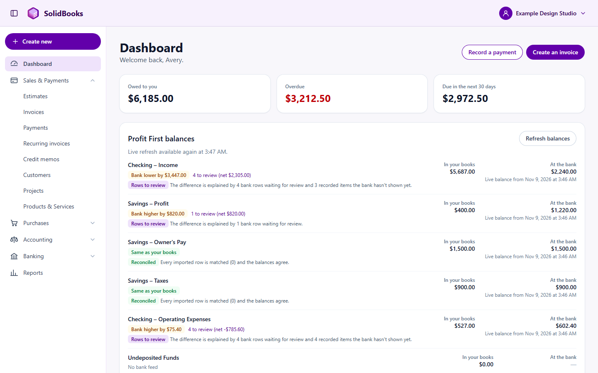

<sub>All data shown is fictional. "Example Design Studio" and its customers do not exist.</sub>

</div>

> **About this repository.** SolidBooks is a real, proprietary application that Solid Code
> Solutions LLC uses in production to run its own invoicing, payments and bookkeeping. This
> repository is a curated engineering showcase: an overview of the product, its architecture,
> and a few self-contained code samples taken from it. The complete implementation remains
> private.

## Contents

[The problem](#the-problem) · [The solution](#the-solution) · [Screenshots](#screenshots) ·
[Architecture](#architecture) · [Engineering highlights](#engineering-highlights) ·
[Code samples](#code-samples) · [Testing and reliability](#testing-and-reliability) ·
[Technology](#technology) · [About](#about-solid-code-solutions-llc)

## The problem

A growing service business runs on money moving through many hands: estimates, invoices,
card payments, bank transfers, monthly retainers, several bank accounts, and a bookkeeper
trying to make it all agree. Off-the-shelf tools covered pieces of this, but left the hard
parts to people:

- **Fragmented workflows.** Invoicing, payment processing, banking and bookkeeping lived in
  separate tools, and every hand-off was manual.
- **Manual reconciliation.** Every bank deposit, payout and transfer had to be matched to an
  invoice or an entry by hand, every month.
- **Disconnected payments.** Card payments, bank transfers and person-to-person payments
  arrived through different channels and were recorded differently.
- **Recurring billing administration.** Monthly retainers and hosting plans meant
  remembering to bill, chasing authorizations and checking who had paid.
- **Accounting that has to be right.** Books feed taxes and business decisions. They need to
  balance, keep their history and explain every number.

The company needed one purpose-built system of record, shaped around how it actually works.

## The solution

SolidBooks replaced the previous accounting service for Solid Code Solutions LLC in a direct
cutover, with the prior history imported and reconciled. It is in daily production use for
invoicing, payments and bookkeeping.

**Sales and billing**

- Customers, projects, products and services, with searchable selectors that create what is
  missing without leaving the page
- Estimates with **Billing Plans**: bill a project in milestones (deposit, design approval,
  launch) and track what has been invoiced and collected
- Invoices with numbered revisions, credit memos, refunds and customer statements
- Branded invoice emails with a PDF and a private **View & Pay** link
- **Recurring invoices** that are generated, approved and emailed on schedule, with a
  **preview** of exactly what the customer will receive before anything is billed

**Getting paid**

- A secure, mobile-friendly customer payment page: bank transfer details, Zelle, or card
- **Stripe** card payments with processing fees recorded automatically
- **Customer-authorized automatic payments** for recurring services, with clear terms and
  self-service card replacement and cancellation
- Payment recording for ACH, wire, Zelle, check, cash and card, with receipts

**Banking**

- **Plaid** bank feeds that sync daily, keeping each transaction exactly as the bank sent it
- **Automated reconciliation** rules that match deposits, transfers and payouts to what is
  already recorded, with everything else queued for review
- **Profit First** account management: income, profit, owner's pay, tax and operating
  accounts, with transfers between them recognized automatically
- A live comparison of every bank balance with the books, explaining any difference

**Accounting and reporting**

- **Double-entry general ledger** with immutable entries, corrections by reversal, closed
  periods and a complete audit trail
- Profit and Loss (cash or accrual), Balance Sheet, Trial Balance, General Ledger and
  receivables aging, with CSV export

**Operations**

- Scheduled workflows: daily bank sync, recurring billing and payment-status checks
- Issued documents stored unchanged and replicated; nightly encrypted database backups with
  rehearsed restores

### Status in production (November 2026)

|                                         | Capabilities                                                                                                                                                                                                                                                      |
| --------------------------------------- | ----------------------------------------------------------------------------------------------------------------------------------------------------------------------------------------------------------------------------------------------------------------- |
| **In daily use**                        | Invoicing, estimates and Billing Plans, invoice email, the customer payment page, card payments, payment recording, bank feeds, reconciliation rules, the ledger and reports, the recurring invoice preview                                                       |
| **Live, first runs scheduled**          | Recurring invoice schedules for the company's retainer and hosting customers                                                                                                                                                                                      |
| **Live, awaiting first production use** | Automatic card charges for authorized recurring customers (verified end to end in the payment processor's test mode); automatic posting of processor payouts (running in review-only mode until the first live payout is verified); bank statement reconciliation |
| **Built, switched off by policy**       | Automatic payment reminders and automatic receipt emails, pending the owner's go-ahead                                                                                                                                                                            |

## Screenshots

<table>
  <tr>
    <td width="50%">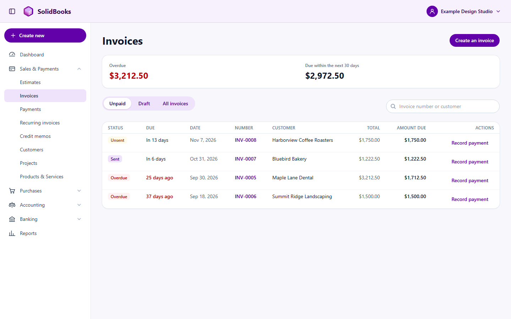<br/><b>Invoices.</b> Status, due dates and balances at a glance.</td>
    <td width="50%">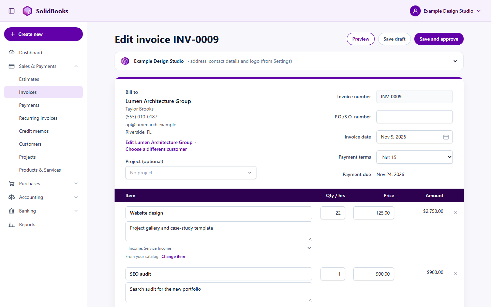<br/><b>Invoice editor.</b> Catalog items, hours and rates, terms and due date.</td>
  </tr>
  <tr>
    <td>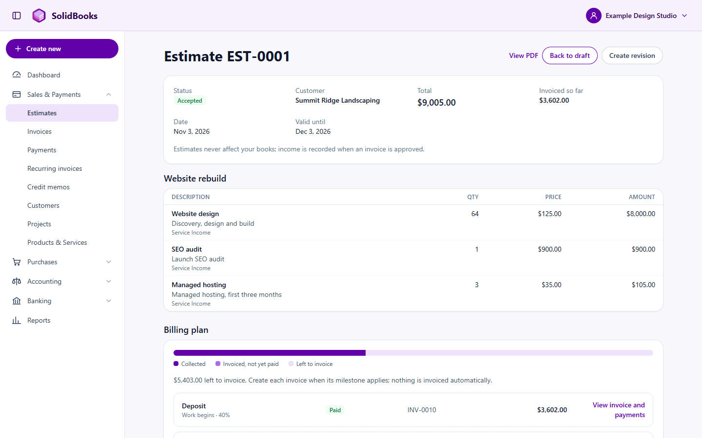<br/><b>Estimates and Billing Plans.</b> Milestones invoiced and collected.</td>
    <td>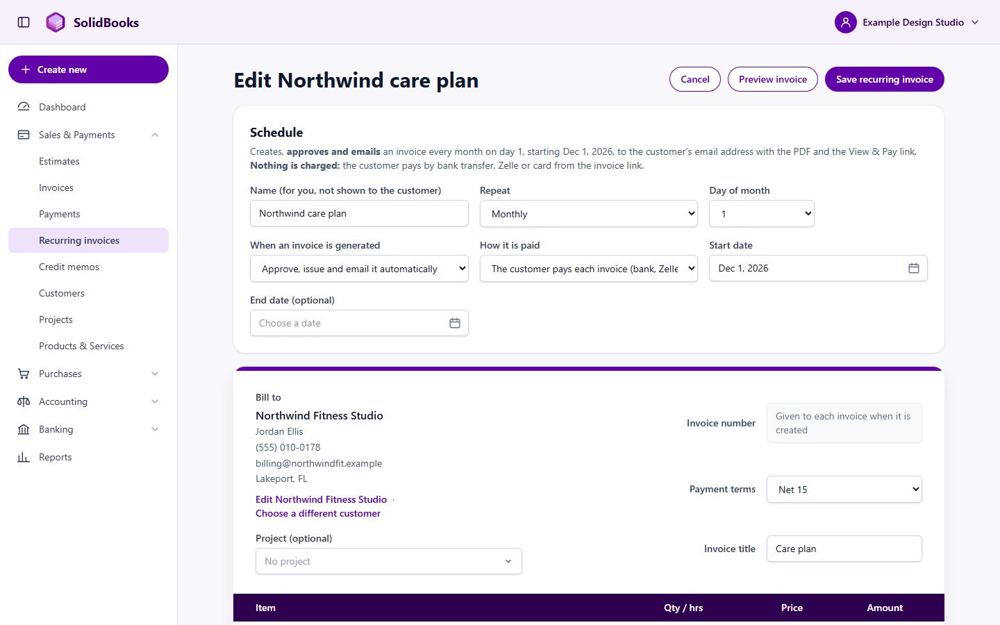<br/><b>Recurring invoices.</b> Schedule, delivery and how it is paid.</td>
  </tr>
  <tr>
    <td>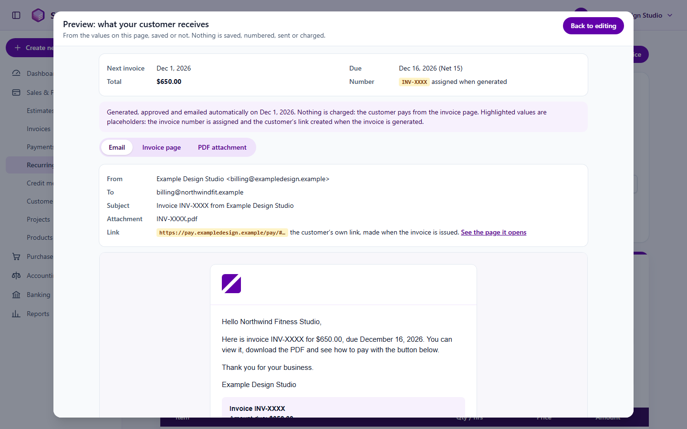<br/><b>Recurring preview.</b> The exact email, page and PDF, before anything is sent.</td>
    <td>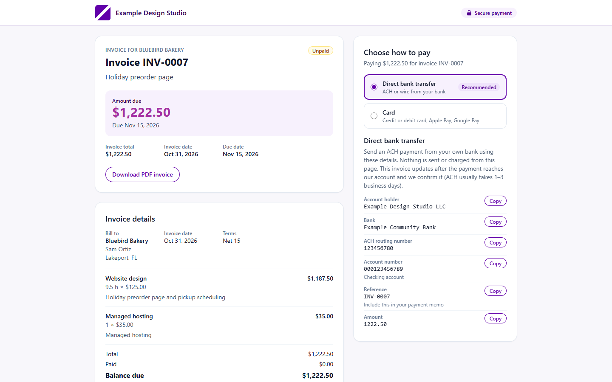<br/><b>Customer payment page.</b> Bank transfer details or card, in one place.</td>
  </tr>
  <tr>
    <td>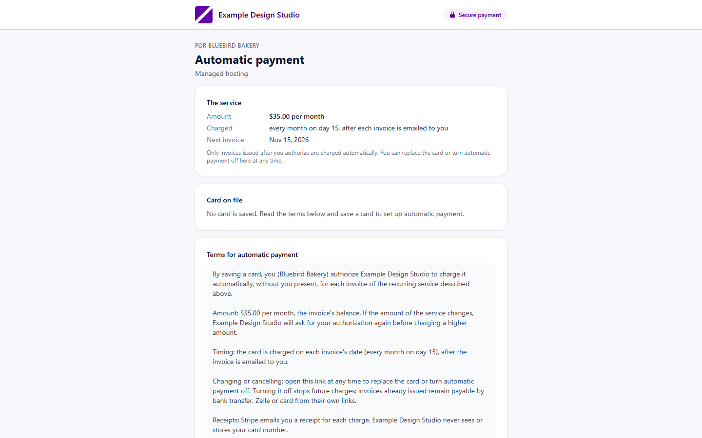<br/><b>Card authorization.</b> Plain-language terms the customer agrees to.</td>
    <td>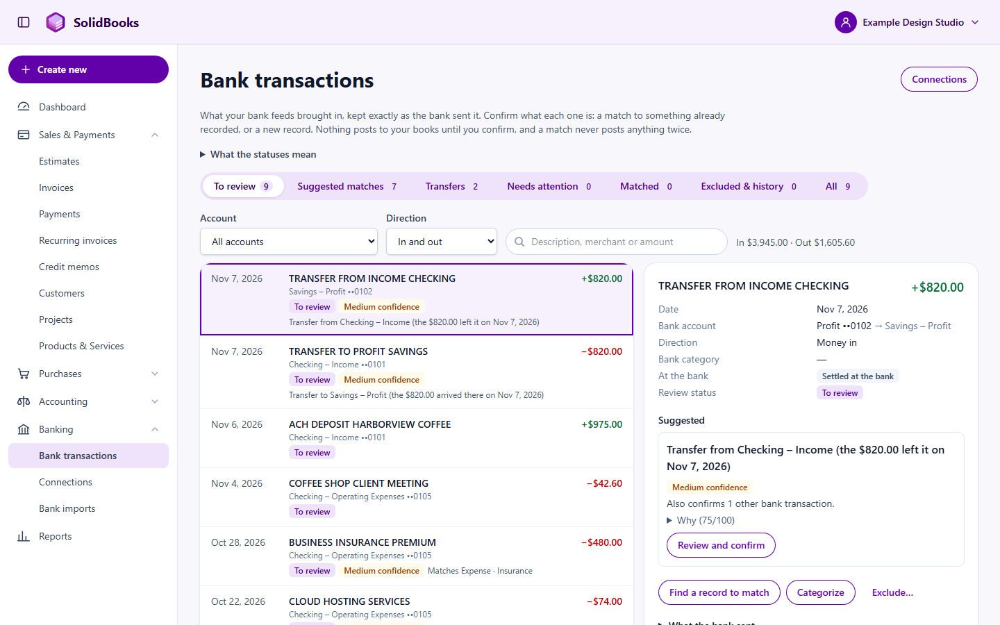<br/><b>Banking and reconciliation.</b> Suggested matches, with the reasons.</td>
  </tr>
  <tr>
    <td>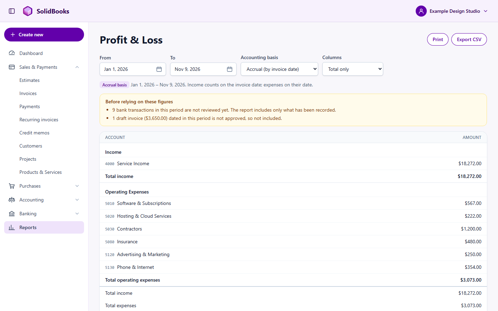<br/><b>Profit and Loss.</b> Cash or accrual, with data-quality warnings.</td>
    <td>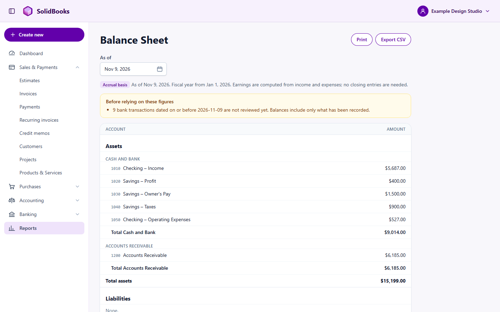<br/><b>Balance Sheet.</b> Straight from the ledger.</td>
  </tr>
  <tr>
    <td>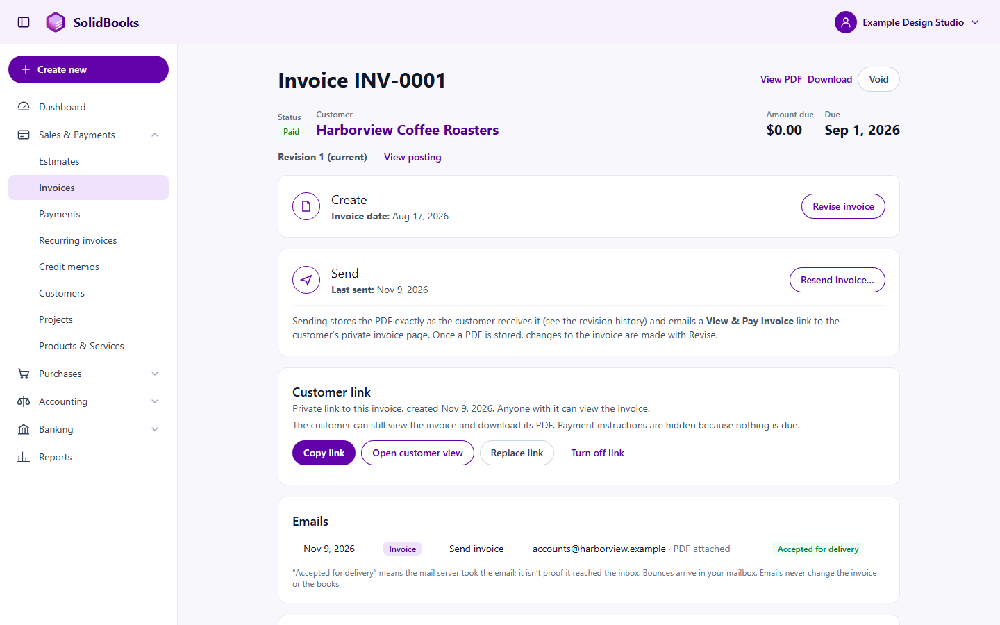<br/><b>Audit history.</b> Revision, customer link and every email sent.</td>
    <td>
      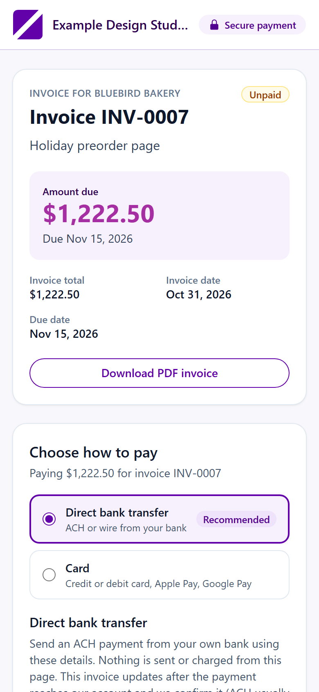
      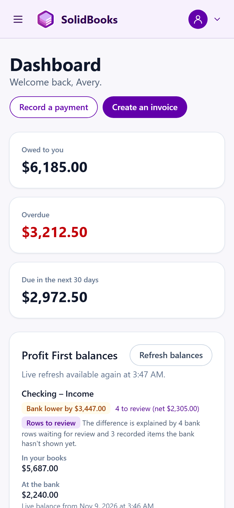<br/><b>On a phone.</b> Customer pages are designed mobile-first.
    </td>
  </tr>
</table>

## Architecture


A React single-page application and isolated customer pages talk to a typed Fastify API.
PostgreSQL is the system of record, and the database itself enforces the accounting rules.
Stripe, Plaid and email are integrated as untrusted inputs: every webhook is verified, every
event is processed exactly once, and amounts are re-fetched from the source before posting.
Scheduled jobs run behind signed platform identities.

- [Architecture](docs/architecture.md): building blocks, request flow, integrations, security model, data protection
- [The accounting engine](docs/accounting-engine.md): integer money, double entry, immutability, reversals, reporting
- [Engineering practices](docs/engineering-practices.md): testing strategy, CI, controlled releases, design rules

<details>
<summary><b>Payment lifecycle</b>: from invoice to reconciled bank deposit</summary>

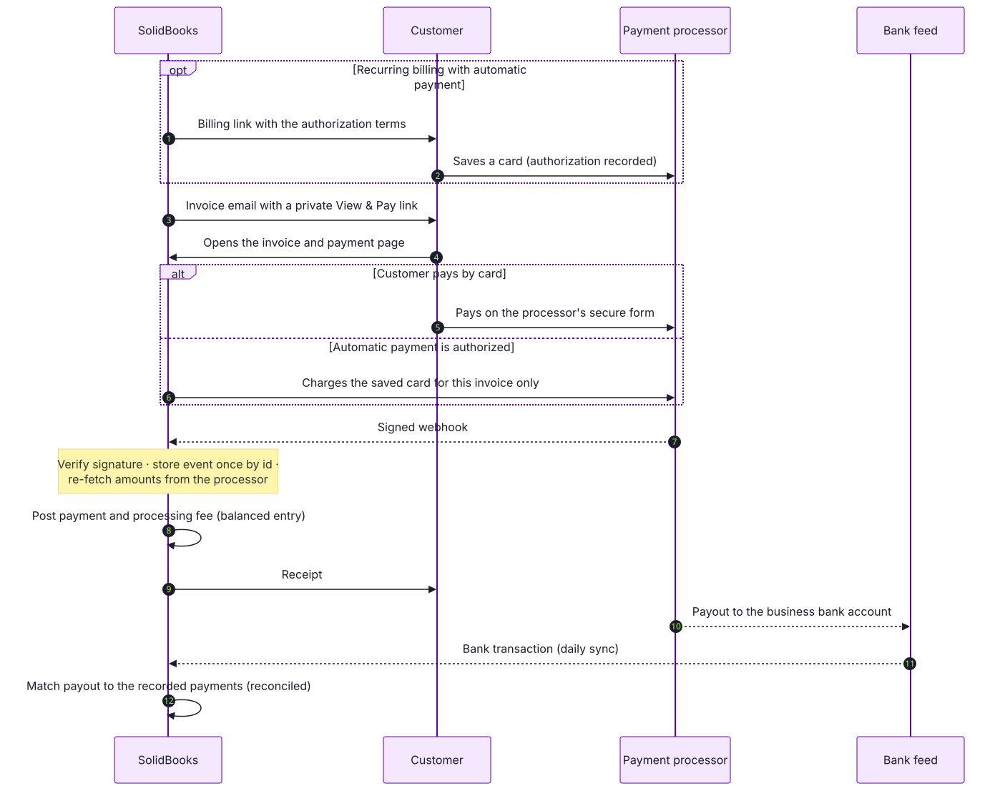

</details>

<details>
<summary><b>Accounting lifecycle</b>: from business event to financial report</summary>


</details>

## Engineering highlights

|                                      |                                                                                                                                                                           |
| ------------------------------------ | ------------------------------------------------------------------------------------------------------------------------------------------------------------------------- |
| **TypeScript domain modeling**       | Strict TypeScript end to end. Zod schemas are both the runtime validation at the API boundary and the static types behind it; statuses and error codes are closed unions. |
| **Integer-cent money**               | No floating point anywhere money is involved. Exact parsing, `bigint` intermediates, deterministic largest-remainder allocation.                                          |
| **Double-entry validation**          | Every financial event is a balanced journal entry posted in the same transaction as the business record and its audit event.                                              |
| **Database-enforced integrity**      | PostgreSQL triggers check balance at commit, seal entries to their transaction, forbid edits and deletes, lock closed periods and keep the audit log append-only.         |
| **Immutable history**                | Corrections are reversals; sent invoices change by numbered revision; the exact PDF each customer received is kept with its hash.                                         |
| **Idempotent processing**            | Create requests carry idempotency keys; webhooks are stored once by event id; recurring billing is keyed by the period it bills. Retries are always safe.                 |
| **Secure webhooks and integrations** | Signatures verified over the raw body before parsing; replay windows; secret rotation; encrypted bank tokens; card data never touches SolidBooks.                         |
| **Reliable recurring billing**       | Generation, approval, email and (with authorization) payment as one idempotent scheduled run, previewable from unsaved edits.                                             |
| **Transaction-safe operations**      | One database transaction per business command, row locks where concurrency matters, deferred checks that leave nothing behind on failure.                                 |
| **Release safeguards**               | Clean-checkout builds, zero-traffic deployments, smoke tests, financial fingerprints before and after, instant rollback.                                                  |

## Code samples

Six small, self-contained samples adapted from the SolidBooks code base. Each has its own
README explaining the design decisions, and tests that run offline.

| Sample                                                 | Demonstrates                                                                                              |
| ------------------------------------------------------ | --------------------------------------------------------------------------------------------------------- |
| [`money`](samples/money)                               | Integer-cent arithmetic, strict parsing, rounding and largest-remainder allocation                        |
| [`double-entry`](samples/double-entry)                 | Type-safe journal validation with precise, per-line error codes; reversals                                |
| [`immutable-ledger`](samples/immutable-ledger)         | PostgreSQL triggers that keep the ledger balanced, sealed and append-only, tested on real PostgreSQL      |
| [`idempotency`](samples/idempotency)                   | Exactly-once command processing: retries, key reuse, failures and concurrent duplicates                   |
| [`webhook-verification`](samples/webhook-verification) | HMAC signature verification over raw bytes, constant-time comparison, replay protection, secret rotation  |
| [`domain-modeling`](samples/domain-modeling)           | Zod and TypeScript modeling of invoices, payment terms, due dates, statuses and recurring-date edge cases |

```sh
# Node.js 22 or later, pnpm 10
pnpm install
pnpm test        # 79 tests across the six samples
pnpm check       # typecheck, lint, formatting and tests
```

The samples need no accounts, keys or network access. The database samples run on
[PGlite](https://pglite.dev), PostgreSQL compiled to WebAssembly, in memory.

## Testing and reliability

Correctness is enforced at several layers, and every change ships with tests for its new
behavior. As of November 2026, the production code base has:

- **1,362 automated tests**: 1,100 API and database integration tests on in-memory
  PostgreSQL, 210 domain tests, and 52 web and document tests
- **164 browser end-to-end scenarios** covering real workflows on desktop and phone
- **116 checks** of invariants and migrations on a PostgreSQL server
- a separate suite against the payment processor's test mode, covering authorization,
  off-session charges, declines, refunds, disputes and payouts

Every push runs secret scanning (including full history), lint, strict type checks, all test
suites, a production container build and a rehearsed backup restore. Releases are deployed
with no traffic, smoke-tested, promoted, and verified against a financial fingerprint taken
before the release. The previous version stays ready for an instant rollback.

## Technology

| Area         | Technologies                                                                           |
| ------------ | -------------------------------------------------------------------------------------- |
| Frontend     | React 19, TypeScript, Vite, TanStack Router and Query, Radix UI, Tailwind CSS          |
| Backend      | Node.js, Fastify 5, Zod, Better Auth (password and TOTP), react-pdf                    |
| Data         | PostgreSQL, Drizzle ORM, database-level invariants                                     |
| Integrations | Stripe (payments and saved cards), Plaid (bank feeds), SMTP email                      |
| Quality      | Vitest, Playwright, PGlite, ESLint, Prettier, Gitleaks                                 |
| Cloud        | Google Cloud: containerized service, scheduled jobs, object storage, encrypted backups |

## About Solid Code Solutions LLC

Solid Code Solutions LLC designs and builds custom software for businesses: web applications,
business automation and integrations that fit how a company actually works. SolidBooks is one
of our own production systems, and it reflects how we build for clients: careful domain
modeling, secure integrations, automated testing and dependable operations.

**Interested in software like this for your business?**
Visit [solidcodesolutionsllc.com](https://solidcodesolutionsllc.com) to get in touch.

---

<sub>
© 2026 Solid Code Solutions LLC. The code samples and their build and test configuration are licensed under the
<a href="LICENSE.md">PolyForm Strict License 1.0.0</a>; documentation, diagrams, screenshots, names
and logos are all rights reserved. See <a href="NOTICE.md">NOTICE.md</a>. SolidBooks itself is
proprietary software and is not open source. All data shown is fictional. Stripe, Plaid,
PostgreSQL, React, Google Cloud and other names are trademarks of their respective owners.
</sub>
