# The accounting engine

SolidBooks is double-entry accounting software first and an invoicing tool
second. Every screen that shows money (invoices, the dashboard, reports, the
bank-versus-books comparison) reads from one general ledger. This document
explains the principles; the [samples](../samples) show them in code.

## Principles

**1. Money is an integer number of cents.** No floating point anywhere: not
in the browser, the API or the database. Parsing rejects ambiguous input
instead of rounding it, multiplication of hours by rates rounds half away from
zero exactly once, and allocations (a partial payment spread across invoice
lines, a milestone percentage of an estimate) use the largest-remainder method
so the parts always add up to the whole. → [`samples/money`](../samples/money)

**2. Every financial event is a balanced journal entry.** Approving an
invoice, recording a payment, a card processing fee, a refund, a transfer
between bank accounts, a confirmed bank transaction: each becomes an entry
whose debits equal its credits, posted in the same transaction as the business
record that caused it. → [`samples/double-entry`](../samples/double-entry)

**3. The database enforces the rules, not just the application.** Balance is
checked by a deferred constraint trigger at `COMMIT`. Lines can only be added
by the transaction that created their entry. Posted lines can never be
updated or deleted. Closed periods are locked. Audit events are append-only.
An application bug can produce an error message, but never an unbalanced or
rewritten ledger. → [`samples/immutable-ledger`](../samples/immutable-ledger)

**4. Corrections are reversals.** A posted entry is never edited. A mistake is
corrected by posting its mirror image (and, if needed, the corrected entry),
so reports for any past date stay reproducible and the history explains
itself. Invoices follow the same idea: once sent, an invoice is changed by a
numbered revision, and the PDF the customer received is kept unchanged.

**5. Derived values are computed, never stored.** "Overdue", "partially paid"
and "paid" come from the live balance and today's date. Account balances come
from the ledger. Nothing can drift out of sync because there is nothing to
keep in sync. → [`samples/domain-modeling`](../samples/domain-modeling)

**6. Reports are views of the same ledger.** Profit and Loss (on an accrual or
cash basis), the Balance Sheet, the Trial Balance, the General Ledger and
receivables aging are all queries over posted entries. Cash-basis reporting
is supported by recording, with each payment, which income it settled.

## Banking and reconciliation

Bank data is evidence, not bookkeeping. Imported bank transactions are kept
exactly as received and never posted on their own. Each one is either matched
to something already recorded (a customer payment, a transfer between the
business's accounts, a processor payout) or turned into a new record by the
owner or by an explicit, owner-approved rule. A match never posts anything
twice.

The dashboard compares every bank account's live balance with the books and
explains the difference: transactions still waiting for review, items
recorded in the books that the bank hasn't shown yet, and anything left
unexplained.

The business uses the **Profit First** method (separate accounts for income,
profit, owner's pay, taxes and operating expenses), and SolidBooks recognizes
transfers between those accounts automatically.

## What stays private

The production engine also includes the business posting rules for every
transaction type, payment allocation and credit handling, deferred revenue,
held and disputed card payments, the bank matching and automation rules,
statement reconciliation, year-end procedures and migration tooling. These are
proprietary to Solid Code Solutions LLC and are not part of this repository.
