# Architecture

SolidBooks is a single-business system of record: one company's invoicing,
payments, banking and double-entry bookkeeping in one application. This
document describes its design at a level that is safe to publish; operational
details of the production deployment are intentionally left out.

## Building blocks

| Part           | Technology                                                                    | Responsibility                                                                                                                                 |
| -------------- | ----------------------------------------------------------------------------- | ---------------------------------------------------------------------------------------------------------------------------------------------- |
| Web app        | React 19, TypeScript, Vite, TanStack Router and Query, Radix UI, Tailwind CSS | The owner's application: sales, payments, banking, accounting, reports, settings                                                               |
| Customer pages | Same React code base, separate entry point                                    | The private invoice and payment page, and the card-authorization page for automatic payments. No owner data or session is ever available there |
| API            | Node.js, Fastify 5, TypeScript, Zod                                           | One typed HTTP API; every request and response is validated against shared Zod contracts                                                       |
| Database       | PostgreSQL, Drizzle ORM                                                       | The system of record. Accounting invariants are enforced by the database itself ([accounting engine](accounting-engine.md))                    |
| Documents      | react-pdf                                                                     | Invoices, estimates, receipts and statements, rendered from the same data the customer sees online                                             |
| Integrations   | Stripe, Plaid, SMTP email                                                     | Card payments and saved cards; bank feeds; invoice, receipt and reminder email                                                                 |
| Hosting        | Google Cloud, containerized                                                   | A stateless container image, scheduled jobs, object storage for issued documents                                                               |

The code is a TypeScript monorepo: the API, the web app and shared packages
for contracts (API schemas), pure domain logic (money, journal rules, dates,
matching) and document rendering. Domain logic has no I/O, so it is tested
directly and reused by both the API and the browser.

## Request flow

1. The browser calls `/api/v1/...` on the same origin; there is no CORS
   surface. Sessions are `HttpOnly`, `Secure`, `SameSite=Lax` cookies.
2. Fastify authenticates the session **and** requires an enrolled
   authenticator (TOTP) before the request body is even parsed.
3. The route validates input with its Zod contract, then runs a **business
   command**: one database transaction that changes records, posts any
   journal entry and writes an audit event together.
4. Database invariants are checked at `COMMIT`. Either everything is
   recorded, or nothing is.
5. The response is validated against its contract on the way out.

Create commands require an `Idempotency-Key`, so a retried request never
records anything twice ([sample](../samples/idempotency)).

## Integrations, treated as untrusted input

- **Payments.** Card payments are taken on the processor's own secure form;
  card numbers never reach SolidBooks. Payment results arrive by signed
  webhook, verified over the raw body before anything is read
  ([sample](../samples/webhook-verification)). Each event is stored once by
  its id; amounts are re-fetched from the processor before posting.
- **Automatic payments.** A customer authorizes a card on a dedicated page
  that shows the exact terms (amount, schedule, how to cancel). Only invoices
  issued after the authorization are charged, each one individually.
- **Bank feeds.** Bank transactions are imported daily and kept exactly as the
  bank sent them. Matching rules propose or record matches to existing
  payments and transfers; anything unrecognized waits for the owner. Feed
  webhooks are verified with the provider's public-key signatures, and access
  tokens are encrypted at rest.
- **Email.** Every send is recorded with its outcome. Failed or uncertain
  sends are never retried blindly; they are resent from the record with the
  same content.

## Scheduled work

Background jobs (daily bank sync, recurring billing, payment-status sweeps,
backups) call internal endpoints that accept only a signed identity token
from the platform scheduler. Every job is idempotent: recurring billing is
keyed by the period it bills, so running a job twice never bills twice.

## Security model

- **One owner account.** Public sign-up is disabled; the owner account is
  created by a command-line bootstrap that refuses to run twice.
- **Two factors everywhere.** Password plus authenticator for every session,
  and a fresh authenticator code (step-up) for sensitive changes such as the
  bank details shown to customers.
- **Default deny.** An automated test enumerates every API route and checks
  its authentication requirement, so a new route cannot ship unprotected by
  accident.
- **Customer links** are long random tokens, stored only as hashes and
  carried in the URL fragment (never sent in `Referer` headers or server
  logs). Every failure returns the same response, so links cannot be probed.
- **Least privilege in the database.** The application connects with a role
  that cannot bypass row-level rules or drop the integrity triggers;
  migrations run separately with their own role.
- **Hardened responses.** A strict Content Security Policy, HSTS, no framing,
  no-store caching and no-referrer on customer pages, and rate limits on
  authentication and public endpoints. Spreadsheet exports neutralize formula injection.

## Data protection and recovery

- **Issued documents are immutable.** The PDF a customer received is stored
  with its SHA-256 hash and replicated to a second region, so it can always be
  reproduced exactly.
- **Encrypted backups.** The database is dumped nightly and before every
  schema change, encrypted to an offline key.
- **Restore drills.** Restores are rehearsed on a schedule and in CI, and
  verified against the source (balanced entries, a zero trial balance, row
  counts and totals).

See [engineering practices](engineering-practices.md) for testing and the
release process.
