# Engineering practices

SolidBooks runs a real company's books, so the bar is correctness first. These
are the practices that keep it there.

## Tests are part of every change

A change is not done until the tests for its new behavior exist and pass:
database invariants for anything involving money, and a browser scenario for
any new workflow. As of November 2026 the production code base has:

| Layer                        | What is tested                                                                                                                                                                                      | Count         |
| ---------------------------- | --------------------------------------------------------------------------------------------------------------------------------------------------------------------------------------------------- | ------------- |
| API and database integration | Business commands end to end against an in-memory PostgreSQL ([PGlite](https://pglite.dev)): postings, invariants, idempotency, authorization, integrations against scripted payment and bank fakes | 1,100         |
| Domain logic                 | Pure functions: money, journal rules, dates, matching, parsing                                                                                                                                      | 210           |
| Web and documents            | UI logic and PDF rendering                                                                                                                                                                          | 52            |
| Browser end-to-end           | Real workflows in a real browser (Playwright), desktop and phone                                                                                                                                    | 164 scenarios |
| Real PostgreSQL              | Invariants and migrations checked on a PostgreSQL server                                                                                                                                            | 116 checks    |

Integration tests use the real API and a real PostgreSQL engine compiled to
WebAssembly, so the database triggers under test are the production ones.
External services are replaced by scripted fakes; a separate suite exercises
the payment processor's actual test mode.

Some tests guard the guards: one enumerates every API route and checks that
it requires authentication; others confirm that previews and dry runs create,
number, send and post nothing.

## Continuous integration

Every push runs:

- secret scanning of the tracked files and of the full git history;
- lint, strict TypeScript checks, and a check that database migrations match
  the schema;
- the unit, integration and database suites;
- the browser end-to-end suite;
- a production container build, booted as the least-privileged database role,
  plus a rehearsal of the encrypted backup and the restore drill.

## Controlled releases

Production changes are deliberate and reversible:

1. **Build** the container from a clean checkout of the exact commit, so no
   local file can slip into an image.
2. **Fingerprint** the books (read-only): row counts, ledger totals and the
   migration history.
3. **If the schema changes:** take a recovery point and an encrypted backup
   first. Migrations are additive only, so the previous version keeps running
   on the new schema.
4. **Deploy** the new revision with no traffic, diff its configuration against
   the running one, and smoke-test it on its own URL.
5. **Promote** it, then fingerprint again: the books must be unchanged by the
   release itself.
6. **Keep** the previous revision ready; rollback is one command.

## Design rules that prevent whole classes of bugs

- **Make invalid states unrepresentable.** Closed unions for statuses and
  error codes; `readonly` value types; Zod schemas that are both the runtime
  validation and the static type.
- **No hidden clocks.** Business dates are computed in the company's time
  zone at the edge and passed in; domain functions never call `Date.now()`.
- **One transaction per business command.** The record, its journal entry
  and its audit event commit together or not at all.
- **Idempotency everywhere money moves.** Create requests, webhooks and
  scheduled jobs can all be retried safely.
- **Untrusted input stays untrusted.** Webhooks are verified before parsing,
  amounts are re-fetched from the source, and customer-facing pages are
  isolated from owner data.
- **Errors explain themselves.** Database violations carry specific codes; the
  API returns problem details with a clear title and next step.

## Accessibility and usability

The interface follows written UX guidelines: keyboard and screen-reader
support, validation that never shows errors on an untouched form, searchable
selectors that can create what is missing without losing work, and
consistent document editors for estimates, invoices and recurring schedules.
Customer-facing pages are designed for phones first.
